<!-- Every image here is generated by assets/build.py. Edit the copy there, then run it. -->

  

  <b><a href="mailto:pratham1024@gmail.com">pratham1024@gmail.com</a></b> · <a href="https://www.linkedin.com/in/prathameshppawar/">LinkedIn</a> · <a href="#plain-text-version">Plain-text version</a>

  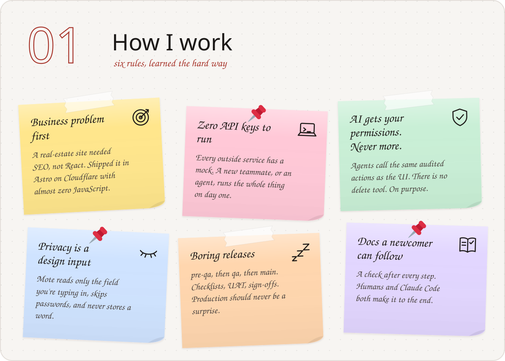

  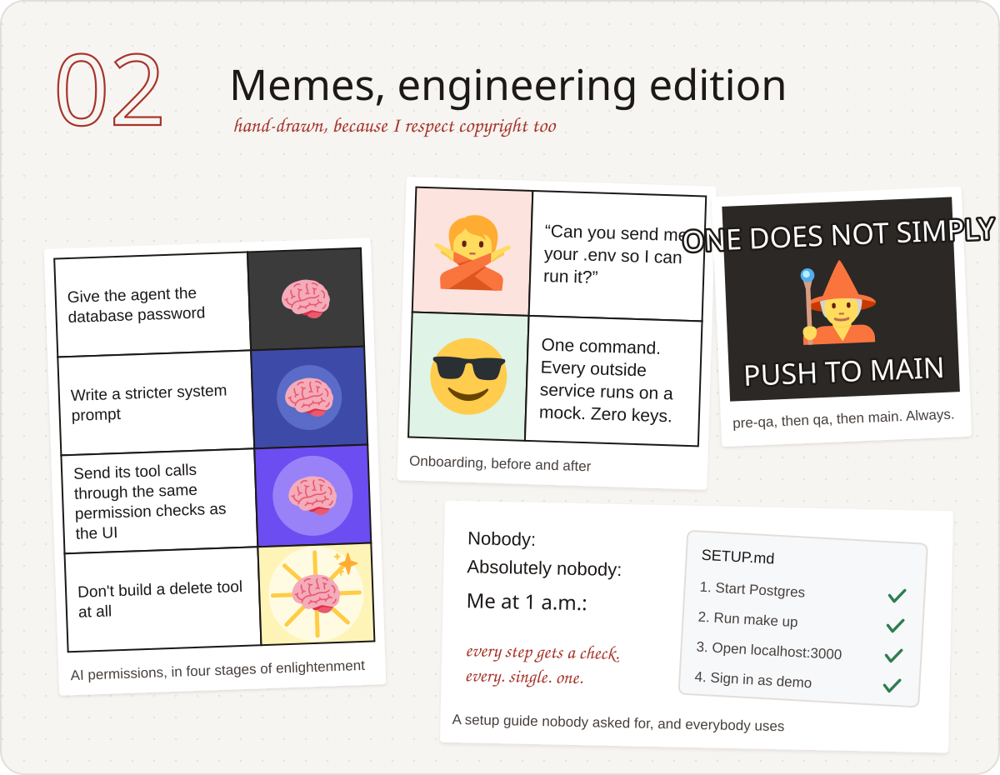

  

  <a href="https://github.com/Prathameshppawar/mote">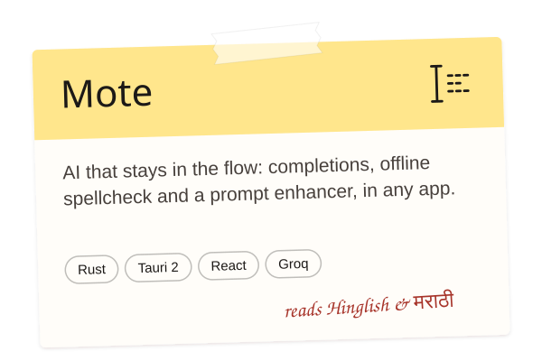</a>
  <a href="https://github.com/Prathameshppawar/taskforge">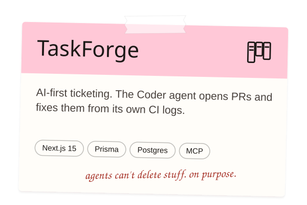</a>
  <a href="https://github.com/Prathameshppawar/ideavault">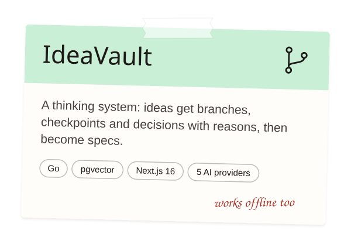</a>
  <a href="https://github.com/Prathameshppawar/claude-context-sync">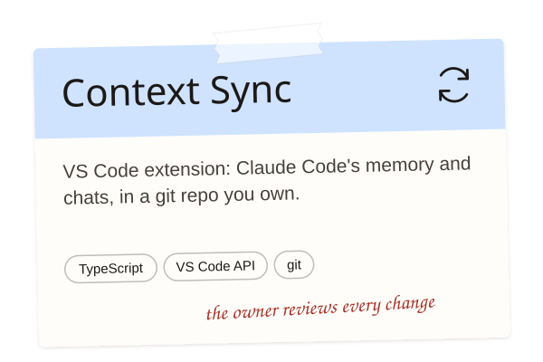</a>
  <a href="https://github.com/Prathameshppawar/zoho-to-sharepoint">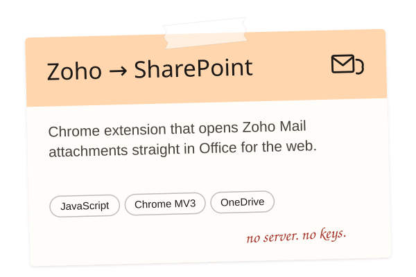</a>
  <a href="https://github.com/Prathameshppawar/Orbits">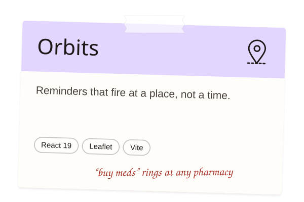</a>

  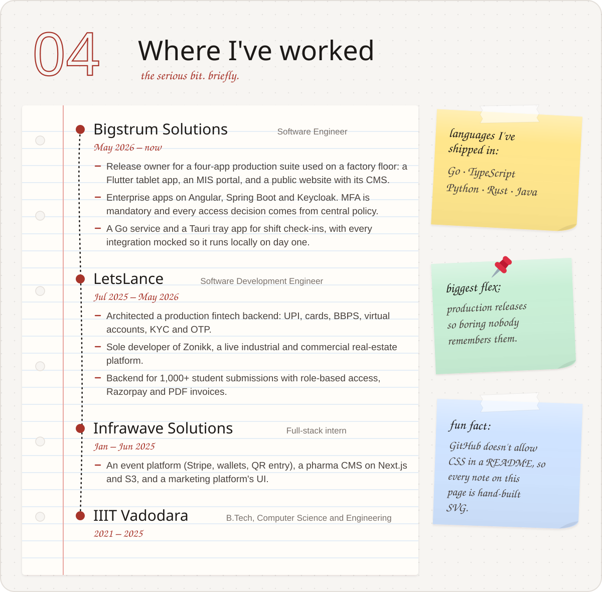

  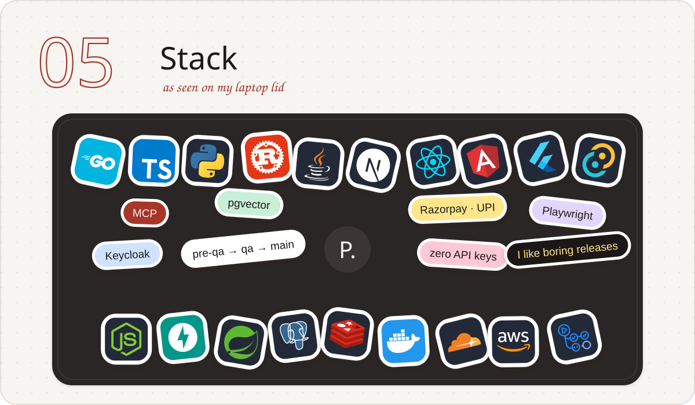

  <a href="mailto:pratham1024@gmail.com"></a>

<!--
Consulting pitch: uncomment once Bigstrum confirms in writing that outside work is fine
(NDA section 2.2 lets them waive the non-compete), or after the restriction ends.

<b>I take on a small number of engagements at a time:</b> zero-to-production builds with docs your team can run, AI features that act within your permission model, and architecture reviews before a system meets real users or real money.

-->

<b>Plain-text version</b> (for screen readers, recruiters and search)

### Prathamesh Pawar, software engineer

I build software end to end: I sit with the people who have the problem, pick the architecture, build it (these days with a crew of AI agents that I brief and whose every diff I review), and own the release. My work so far has covered payments and KYC, a factory floor, public-sector operations, pharma and healthcare, and a handful of developer tools.

**How I work**

- **Business problem first, stack second.** A real-estate consultancy needed content and search ranking, not interactivity, so I built its site in Astro on Cloudflare Workers with almost no client-side JavaScript.
- **Runs on a fresh laptop with no API keys.** Every outside service sits behind an adapter with a mock, so a new teammate, or an agent, can run the whole system on day one.
- **AI gets your permissions, never more.** In TaskForge the Copilot, the coding agents and the MCP server call the same permission-checked, audited actions as the UI. There is no delete tool.
- **Privacy is a design input.** Mote reads only the field you're typing in, skips password fields, and never stores what you type.
- **Boring releases.** `pre-qa → qa → main`, checklists, UAT sign-offs, release notes.
- **Docs a newcomer can follow.** Setup guides with a check after every step.

**Things I've built**

- [Mote](https://github.com/Prathameshppawar/mote): inline completions, offline spellcheck and a prompt enhancer in any app on macOS and Windows (Rust, Tauri 2, React, Groq)
- [TaskForge](https://github.com/Prathameshppawar/taskforge): AI-first ticketing whose Coder agent opens pull requests and fixes them from its own CI logs (Next.js 15, Prisma, Postgres, MCP). [Live demo](https://taskforge-nine-mu.vercel.app)
- [IdeaVault](https://github.com/Prathameshppawar/ideavault): a thinking system with branches, immutable checkpoints and decisions with reasons (Go, pgvector, Next.js 16)
- [Context Sync for Claude Code](https://github.com/Prathameshppawar/claude-context-sync): Claude Code's memory and chats in a git repo you own (TypeScript, VS Code API)
- [Zoho → SharePoint](https://github.com/Prathameshppawar/zoho-to-sharepoint): opens Zoho Mail attachments in Office for the web (Chrome MV3)
- [Orbits](https://github.com/Prathameshppawar/Orbits): reminders that fire at a place, not a time (React 19, Leaflet)
- Earlier AI experiments: [nl2sql-chatbot](https://github.com/Prathameshppawar/nl2sql-chatbot), [rag-multi-modal](https://github.com/Prathameshppawar/rag-multi-modal), [gemini-researcher-multi-modal](https://github.com/Prathameshppawar/gemini-researcher-multi-modal), [deepseek_fine_tuning](https://github.com/Prathameshppawar/deepseek_fine_tuning), [working_with_Langgraph](https://github.com/Prathameshppawar/working_with_Langgraph)

**Where I've worked**

- **Bigstrum Solutions**, Software Engineer, May 2026 – present. Release owner for a four-app production suite used on a factory floor (Flutter tablet app, MIS portal, public website and CMS on FastAPI and Next.js). Enterprise apps on Angular, Spring Boot and Keycloak with mandatory MFA and policy-based access. A Go service and Tauri tray app for shift check-ins with every integration mocked.
- **LetsLance**, Software Development Engineer, Jul 2025 – May 2026. Production fintech backend for UPI, cards, BBPS, virtual accounts, KYC and OTP (Node.js, PostgreSQL, Redis, Docker). Sole developer of Zonikk, a live real-estate platform (React, Sanity CMS). Backend for 1,000+ student submissions with RBAC, Razorpay and PDF invoices.
- **Infrawave Solutions**, Full-stack intern, Jan – Jun 2025. Event platform backend (Stripe, wallets, QR entry), a pharma CMS on Next.js and S3, and a marketing platform's UI.
- **IIIT Vadodara**, B.Tech in Computer Science and Engineering, 2021 – 2025.

**Stack:** Go, TypeScript, Python, Rust, Java · Next.js, React, Angular, Flutter, Tauri, Astro · Node.js, FastAPI, Spring Boot · PostgreSQL (pgvector), Redis · Keycloak, Auth.js, Supabase · Razorpay, Stripe, UPI, BBPS · Claude, Groq, OpenAI, Gemini, Ollama, MCP · Vitest, Playwright, JUnit, Testcontainers · Docker, GitHub Actions, Cloudflare Workers, AWS, Vercel

**Contact:** [pratham1024@gmail.com](mailto:pratham1024@gmail.com) · [LinkedIn](https://www.linkedin.com/in/prathameshppawar/)

Emoji art: <a href="https://github.com/jdecked/twemoji">Twemoji</a> (CC-BY 4.0) · Fonts: Archivo, Kalam, Anton (SIL OFL) · Icons: <a href="https://skillicons.dev">skillicons.dev</a>

